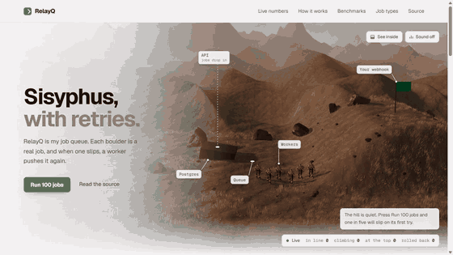

# RelayQ

**A multi-tenant background-job service that doesn't lose or double-run jobs, even when workers are killed mid-flight.**

**[Live demo →](https://relayq-demo.onrender.com/demo)** (free tier: the first visit after 15 min idle takes ~1 min to wake)

[](docs/demo.mp4)

Every boulder in the demo is a real job going through the real queue, and each push is a real HTTP call.

| | |
|---|---|
| Throughput | **33,424 jobs/min**, 0 lost of 167,133 (one laptop, 3 workers × 5) |
| Enqueue latency | p95 **130.6 ms**, median 85.4 ms |
| Chaos test | 10k jobs, 10 worker `SIGKILL`s + an API kill → **0 lost, 0 duplicated** |

## How it works

- **No lost jobs:** `POST /jobs` writes the job and an outbox row in one Postgres transaction; a relay publishes the outbox to BullMQ with `SELECT … FOR UPDATE SKIP LOCKED`. A crash between "saved" and "queued" can't drop a job.
- **No double effects:** side effects go through `once()`, an effect log keyed per job and step, and downstream calls carry an `Idempotency-Key`. A re-delivered job skips what already happened.
- **Retries:** exponential backoff, a dead-letter queue with manual retry, per-tenant rate limits and queue caps, and idempotency keys on enqueue (24 h).
- **Tracing:** OpenTelemetry `traceparent` flows from the client app through the API, outbox and relay to the worker, so one request shows as one trace. Prometheus and Grafana run in compose.
- **Safe outbound calls:** webhooks are HMAC signed; tenant URLs that resolve to private, loopback or cloud-metadata addresses are refused at connect time.
- **AI jobs:** `llm.complete` enforces per-tenant monthly budgets, a shared tokens-per-minute limit and a fallback model, and writes a cost ledger. `embed.batch` batches across jobs. `ml.retrain` promotes a new model only if its test MAE is no worse than the current one.
- **Real client:** [PulseBoard](https://github.com/puravbhatt0504/pulseboard) (a board app) sends its email digests, board exports and embeddings through RelayQ.
- **Cloud:** AWS CDK stack (ECS Fargate autoscaled on queue depth, RDS, ElastiCache, S3, CloudFront) that deletes itself on a fixed date and has a $25 budget alarm.

Plan and contracts: [PLAN.md](PLAN.md).

## Run locally

```bash
docker compose up -d --build                                  # api :3200, 3 workers, redis, postgres, mailhog :8025, prometheus :9090, grafana :3001
docker compose exec api node dist/cli/create-key.js my-tenant # prints an rq_ key once
curl -X POST localhost:3200/jobs -H "authorization: Bearer rq_..." -H "content-type: application/json" \
  -d '{"type":"webhook.deliver","payload":{"url":"https://example.com/hook","body":{"hi":1}}}'
```

Tests (need Docker for Testcontainers): `npm test`.

## API

| Route | |
|---|---|
| `POST /jobs {type, payload, idempotencyKey?, delayMs?, priority?}` | `202 {jobId}`; same idempotency key within 24 h → `200` with the original id; `429` over 10,000 queued per tenant |
| `GET /jobs/:id` | `{id, type, status, attempts, result?, error?}` |
| `POST /jobs/:id/retry` | re-queue a `dead` job |
| `GET /models/:name` | promoted model version + version history (`ml.retrain` registry) |
| `GET /llm/usage?month=YYYY-MM` | this tenant's LLM spend for the month, budget left, per-model tokens and cost |
| `PUT /admin/budgets/:tenant {monthlyUsdLimit}`, `GET /admin/budgets` | set / list monthly LLM budgets (admin basic auth; no budget = LLM jobs refused) |
| `GET /metrics`, `GET /health` | Prometheus (bearer `METRICS_TOKEN` if set); `{redis, db}` |
| `/admin/queues` | bull-board, basic auth (`ADMIN_USER` / `ADMIN_PASSWORD`) |

Outbound calls to tenant URLs refuse private, loopback and cloud-metadata addresses (checked at connect time, redirects not followed) unless the host is in `OUTBOUND_ALLOW`.

Job types: `email.digest`, `board.export`, `webhook.deliver` (signed with `X-RelayQ-Signature`, hex HMAC-SHA256 of the body), `embed.batch` (Voyage, batched across jobs), `llm.complete` (Anthropic; per-tenant monthly budget, shared TPM limit, fallback model, cost ledger in `LlmUsage`), `ml.retrain` (runs the trainer image, promotes the new version only if its test MAE ≤ the current one, notifies `MODEL_SUBSCRIBERS_<NAME>`).

## Deploy

**Live demo:** see top.

**Free demo (Render + Neon):** `render.yaml` runs api + relay + workers in one service (`dist/all.js`) with `DEMO=1`, which serves a public page at `/demo`. Free web services sleep after 15 min idle and wake on the next request (~1 min).

**AWS (`infra/`, CDK, ap-south-1):** ECS Fargate api + workers (1–3, autoscaled on queue depth), RDS Postgres, ElastiCache Redis, S3, ALB behind CloudFront (HTTPS). No NAT gateway. Runs for a fixed window: the `RelayQReaper` stack deletes the app stack at `DESTROY_AT` (EventBridge Scheduler, runs in AWS) and emails at 80% / 100% of a $25 budget.

```bash
cd infra && npm ci
DESTROY_AT=2026-10-18T05:44:00Z ALERT_EMAIL=you@example.com npx cdk deploy --all
npx cdk destroy RelayQ   # tear down early
```

## Throughput (measured)

`docker compose --profile load run --rm k6`: 50 VUs enqueue `webhook.deliver` jobs to a local sink for 5 minutes, 3 workers.

| | |
|---|---|
| Jobs enqueued (202) | 167,133 (557/s) |
| Jobs completed | 167,133 in 300.0 s → **33,424 jobs/min** |
| Lost | **0** (`count(completed, dead) == enqueued`; 0 dead, 0 retries) |
| Enqueue latency | p95 **130.6 ms**, median 85.4 ms |

Setup: one laptop, Docker Desktop on Windows 11 (16 vCPU, 11 GiB to Docker), everything in compose.
3 workers × `WORKER_CONCURRENCY=5`; `TENANT_JOBS_PER_MIN` raised to 1,000,000 for the run (default 100 would cap it at 100/min).
Workers kept pace with enqueue the whole run (no backlog formed), so 33k/min is bounded by the enqueue side, a floor for worker capacity, not a ceiling.
